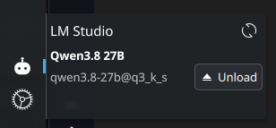

# LMS Model Status

KDE Plasma 6 widget that shows which models [LM Studio](https://lmstudio.ai/) has loaded and lets you unload them. It talks to LM Studio's REST API (no `lms` CLI needed).



- **Filled head** → at least one model is loaded
- **Outline head** → nothing loaded
- **Dimmed** → server unreachable
- Click to open the popup: loaded models, per-instance **Unload** button, refresh button

## How it works

Plasma has no HTTP data engine, so the widget runs `curl` through the `executable` engine (`Plasma5Support.DataSource`):

- `GET {url}/api/v1/models` on a timer → models with non-empty `loaded_instances` are shown
- `POST {url}/api/v1/models/unload` with `{"instance_id": "..."}`, then an immediate refresh

curl failures (`-f`) and `"error"` bodies (LM Studio can answer HTTP 200 with an error) are shown as errors.

## Requirements

- KDE Plasma 6, `curl`
- LM Studio with the local server enabled

## Installation

```bash
kpackagetool6 -t Plasma/Applet -i /path/to/lms_monitor
# update:
kpackagetool6 -t Plasma/Applet -u /path/to/lms_monitor
systemctl --user restart plasma-plasmashell
```

Add it via **Add Widgets → LMS Model Status**.

## Configuration

Right-click → **Configure**: base URL (default `http://127.0.0.1:1234`), optional API key, refresh interval (min 5 s).

**Security:** the key is stored in the per-applet Plasma config (`~/.config/plasma-org.kde.plasma.desktop-appletsrc`), never in the repo (default is empty). It is passed to `curl` on the command line, so it is briefly visible in the process list to local users. Fine for a single-user machine.
